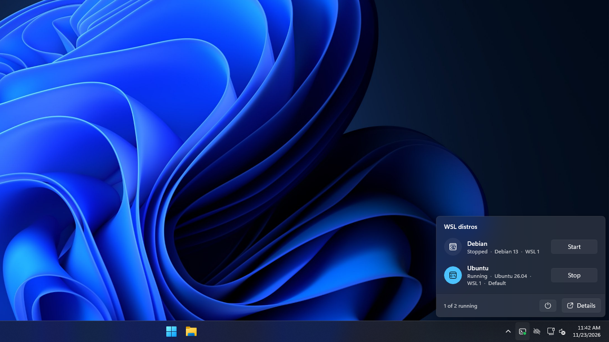
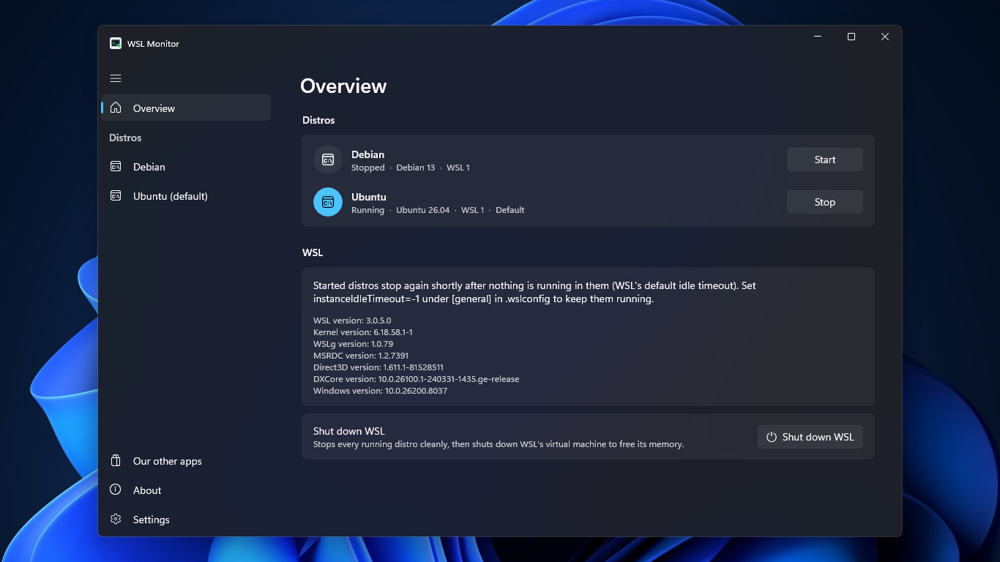
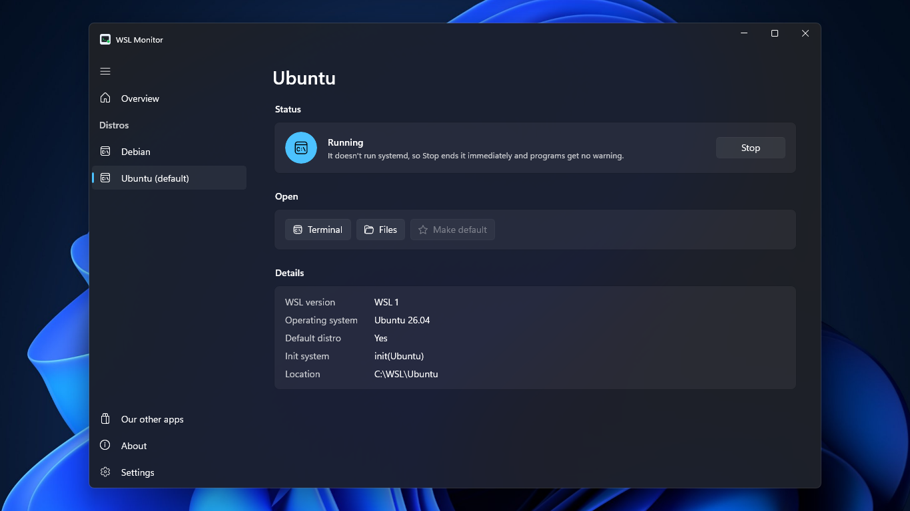

<h1 align="center">Tray Control for WSL</h1>

  See at a glance which of your WSL distros are running, and start or stop them from the Windows tray.

  

  
  &nbsp;
  
  &nbsp;
  

WSL distros keep running in the background, using memory, long after the terminal that started them is closed, and Windows gives no sign of which ones are up. Tray Control for WSL puts that answer in the tray for developers and anyone else who uses WSL: one look shows what is running, and one click starts or stops a distro, without typing `wsl` commands.

## Features

- **Status in the tray:** a green dot means at least one distro is running, amber means one is starting or stopping, and no dot means nothing is running. Hover for a summary.
- **Start and stop with a click:** click the tray icon for a list of your distros with a Start or Stop button for each, and a Details button for the full window.
- **Safe stops:** stopping asks for a second click. Distros that use systemd (Ubuntu's default) shut down cleanly, so services stop in order and programs get a chance to exit. If one hasn't stopped after 2 minutes, you can force it.
- **Shut down WSL:** stop every distro cleanly at once, then free WSL's memory, from the tray or the Overview page.
- **Details for each distro:** its WSL version, location and, for WSL 2, disk size, with shortcuts to a terminal or its files.
- **Fits in:** follows Windows' light or dark theme and language, and can start when you sign in.

## Get it

Get Tray Control for WSL from the **[Microsoft Store](https://apps.microsoft.com/detail/9MTQWTX87B8J)**. It installs and stays up to date automatically. To build it yourself instead, follow the [development guide](docs/development.md).

Tray Control for WSL collects no telemetry or crash reports.

### Requirements

- Windows 11 on x64 or ARM64.
- WSL with at least one installed distro.

## How it works

Tray Control for WSL reads your distros from Windows and checks which ones are running every few seconds. Starting a distro runs an empty command in it. Whether it then keeps running with nothing open in it depends on WSL's idle timeout: the Overview page tells you how yours is set, and how to keep distros running (`instanceIdleTimeout=-1` in `.wslconfig`).

Docker Desktop's own distros are hidden unless you turn them on in Settings.

## Languages

Tray Control for WSL is available in English (United States and Canada), Spanish, French (France and Canada), German, Simplified Chinese, Brazilian Portuguese and Japanese. It follows Windows' language unless you pick one in Settings.

## Developers

- [Development guide](docs/development.md): build, install, checks, and where the app stores data.
- [Agent instructions](AGENTS.md): architecture, behaviour rules and conventions.

## License

Licensed under the [PolyForm Noncommercial License 1.0.0](LICENSE): free for any **personal and other noncommercial use**, including modifying and redistributing it. **Commercial use is not permitted.** Copyright (c) 2026 Dynamic Solutions.
